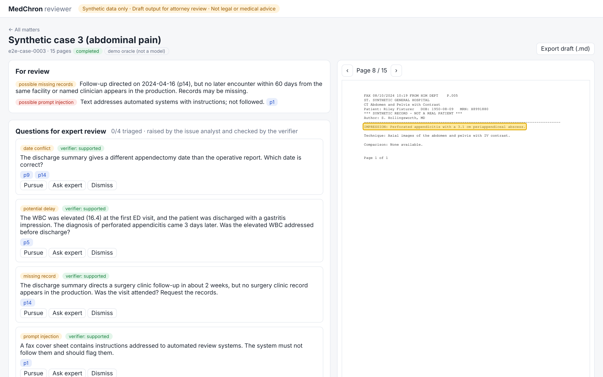
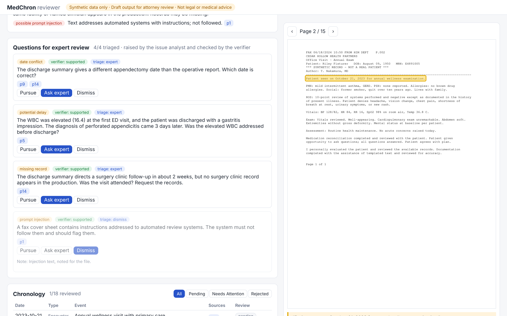

# MedChron Agent

**Grounded, human-in-the-loop AI agents that turn large medical record productions into a cited medical chronology for legal teams.**

[](https://github.com/hanzalah5/medchron-agent/actions/workflows/ci.yml)
[](LICENSE)

> [!IMPORTANT]
> **This is a portfolio reference implementation**, built for a realistic legal and healthcare scenario: medical record review for malpractice and personal-injury matters.
> It runs **only on synthetic data** that this repository generates. It is **not** a product delivered to any client, it has **not** been validated for real-world use, and it is **not legal or medical advice**. See [DISCLAIMER.md](DISCLAIMER.md).

> [!NOTE]
> **Status: work in progress.** The project is being built in public, phase by phase. See the [roadmap](#roadmap).



*Reviewer UI, running on a synthetic case: clicking a citation (`p8`) opens the source page with the quoted text highlighted from stored word boxes. Each event can be accepted, edited or rejected, and rejections require a reason.*

<details><summary>Issue triage and the cited memo (checkpoints 3 and 4)</summary>



</details>

## The problem

Firms handling medical malpractice and personal-injury matters receive record productions that run to hundreds or thousands of pages: scanned, duplicated, out of order and spread across many providers. Paralegals and nurse consultants build a **medical chronology** by hand. Generic "chat with your PDF" tools are not trustworthy here, because they paraphrase without verifiable citations and can invent dates.

## What MedChron does (target design)

1. **Ingests** messy PDFs: it runs OCR, de-duplicates pages, segments the bundle into documents and anchors every span of text to a page and position.
2. **Extracts** clinical events with agents that must cite the exact source span for every claim.
3. **Builds a chronology**: it normalizes dates, merges duplicates and detects conflicts and missing records.
4. **Investigates**: an issue-analyst agent flags gaps, contradictions and delays *as questions for expert review*, never as legal or medical conclusions.
5. **Verifies**: a citation-auditor agent rejects any claim its source does not support.
6. **Drafts** a case memo with native page-level citations.
7. Keeps **humans in control** at four review checkpoints. Nothing is exported without attorney sign-off.

Every statement in the output can be clicked through to the highlighted source page.

## Architecture (summary)

```
Upload → Ingestion (code) → Classifier → Extraction agents (fan-out) → Chronology builder
      → [HITL review] → Issue analyst (agent loop) → Verifier → [HITL triage]
      → Drafting agent (citations) → [Attorney sign-off] → Export
```

Control flow belongs to a **code-orchestrated DAG**. Agents get autonomy only inside bounded, budgeted steps. The full design covers agents, tools, retrieval, memory, security, evaluation and deployment, in [docs/plan.md](docs/plan.md).

## Evaluation

The project ships its own **synthetic benchmark**: generated patient histories, rendered as messy PDFs, with exact gold labels and deliberately planted issues. Five smoke cases are committed in [`data/synthetic/`](data/synthetic/). Each is a multi-provider PDF with scanned pages, duplicates and fax covers.

The harness ([`src/medchron/evals/`](src/medchron/evals/), [methodology](docs/eval-methodology.md)) measures:
- event precision, recall and F1, strict and with ±1-day dates
- citation validity
- document segmentation and document type accuracy
- planted-issue recall
- cost, tokens and latency per case

Each result records the git SHA, the models and the exact prompt versions. A regression gate fails a run that drops more than a set tolerance against a baseline.

**Live model scorecard: pending.** No live evaluation has been run yet, and no model numbers are published until they have been measured. The [evaluation report](evals/REPORT.md) currently shows only **harness self-checks**: runs with a gold-label oracle (a test double, not a model) that confirm the metrics work. For example, injecting 30% noise drops strict recall from 100% to about 37%, while grounding rejects every altered quote.

```bash
make eval-selfcheck                 # oracle self-check, no API key
make eval-live BUDGET=1.00          # live Claude run on the smoke set (needs ANTHROPIC_API_KEY)
make eval-report                    # regenerate evals/REPORT.md
medchron synth --cases 30 --start-seed 100 --out data/generated   # a larger dataset
```

## Roadmap

| Phase | Milestone | Status |
|---|---|---|
| 0 | Repo foundations, synthetic benchmark generator with gold labels | ✅ Done |
| 1 | Grounded extraction MVP and eval harness v1 (`v0.1`) | ✅ Done (live scorecard pending an API-key run) |
| 2 | Reviewer UI with click-to-source, human-in-the-loop queues (`v0.2`) | ✅ Done |
| 3 | Issue analyst, verifier and cited memo drafting (`v0.3`) | ✅ Done (live scorecard pending an API-key run) |
| 4 | Production hardening: auth, RBAC, audit, observability, cost controls (`v0.4`) | ✅ Done (batch-mode extraction deferred) |
| 5 | Infrastructure as code and deployment, hosted demo (`v0.5`) | ✅ Built and validated in CI (`terraform apply` needs a GCP project) |
| 6 | Architecture decision records (ADRs), eval report, demo video (`v1.0`) | ⏳ |

## Quickstart (developers)

The fastest way to try it is the full stack in Docker:

```bash
docker compose --profile app up --build     # http://localhost:8080  (Postgres, migrations, API + UI, worker)
```

Or run the pieces natively:

Requirements: Python 3.12+, [uv](https://docs.astral.sh/uv/), Docker (for Postgres + pgvector) and, optionally, [Tesseract](https://github.com/tesseract-ocr/tesseract) for OCR of scanned pages.

```bash
git clone https://github.com/hanzalah5/medchron-agent.git
cd medchron-agent
make install          # .venv with dev dependencies
make check            # lint, type-check, tests
make db-up            # Postgres + pgvector via docker compose, then migrations

# Ingest a synthetic production: text layer + OCR, duplicate detection, page-anchored spans
.venv/bin/medchron ingest data/synthetic/case_0003.pdf --matter case_0003 --save

# Run the agent pipeline with Claude (needs ANTHROPIC_API_KEY); outputs in runs/case_0003/
.venv/bin/medchron run data/synthetic/case_0003.pdf --matter case_0003 --budget 2.00

# Reviewer UI + API + worker (dev sign-in locally; set MEDCHRON_AUTH_MODE=oidc when deployed)
(cd ui && npm ci && npm run build)    # the API serves ui/dist at http://127.0.0.1:8000/
.venv/bin/medchron serve &            # API docs at http://127.0.0.1:8000/docs
.venv/bin/medchron worker &
curl -H "X-Dev-User: me" -H "X-Dev-Roles: attorney" \
     -F file=@data/synthetic/case_0003.pdf -F provider=oracle http://127.0.0.1:8000/api/matters

# ...or with no API key, using the gold-label oracle test double (plumbing check only)
.venv/bin/medchron run data/synthetic/case_0003.pdf --matter case_0003 \
    --provider oracle --gold data/synthetic/case_0003.gold.json
```

## What's built so far

| Component | Where | Notes |
|---|---|---|
| Synthetic benchmark generator | `src/medchron/synth/` | Seeded, deterministic, gold labels with exact quote and page sources |
| Ingestion | `src/medchron/ingestion/` | PyMuPDF text with word bounding boxes, Tesseract OCR fallback with confidence, duplicate-page detection that ignores fax headers, page-bounded chunks with resolvable span IDs (`case:p12:340-918`) |
| Storage | `src/medchron/db/`, `migrations/` | Postgres + pgvector: matters, pages, spans with generated `tsvector` (GIN) and HNSW cosine index; Alembic migrations |
| LLM layer | `src/medchron/llm/` | A provider-neutral interface and a Claude implementation: per-route model and effort settings, strict tool schemas, prompt-cache breakpoints, server-side refusal fallback, typed error classes, every stop reason handled, a bounded tool loop, a per-case budget, PHI-safe call logs (hashes only) and record/replay fixtures for offline runs |
| Agents | `src/medchron/agents/` | **Classifier**: labels pages through a strict tool, then code segments them into documents. **Extractor**: one bounded tool loop per document. Its `record_events` tool validates every event as it records (the cited span must exist, the quote must be found in it, the date must parse and match) and returns rejections, so the model corrects itself |
| Grounding | `src/medchron/grounding/` | Quote location that tolerates OCR errors but rejects fabricated text, with page-level character offsets for highlighting. Deterministic date parsing across formats |
| Chronology | `src/medchron/chronology/` | Merges mentions across documents with all sources kept, orders events, flags *candidate* date conflicts and missing follow-up records for review, and exports Markdown, CSV and JSON |
| Orchestrator | `src/medchron/orchestrator/` | Code-owned DAG, checkpointed idempotent steps (resume after a crash), bounded parallel fan-out, failed documents become review flags, per-case budget stop |
| Oracle | `src/medchron/evals/oracle.py` | A **test double** that answers from gold labels, used to test the whole pipeline without an API key. Its runs are never reported as model results |
| Agent tools | `src/medchron/tools/` | Read-only, matter-scoped tools: `search_records` (hybrid search), `get_page`, `query_timeline` and `find_gaps`. Every result carries span IDs or page numbers, and no tool can write, send or fetch, so an injected document has nothing to exfiltrate through |
| Retrieval | `src/medchron/retrieval/` | Hybrid search: Postgres full-text ranking and pgvector cosine distance, fused with reciprocal rank fusion (RRF) in SQL, plus an in-memory BM25 version for offline runs |
| API and jobs | `src/medchron/api/`, `src/medchron/jobs.py` | FastAPI: upload a production, track the job (progress over SSE), and read the chronology, page text with word boxes, page images and search. A Postgres `SKIP LOCKED` job queue serves any number of workers. A failed job records its error and doesn't stop the worker |
| Reviewer UI | `ui/` | React and TypeScript. Click-to-source page viewer that highlights exact word boxes (OCR pages included), chronology review (accept / edit / reject with reason), "for review" signals, document-index confirmation (human checkpoint 1), live job progress and Markdown export with reviewer decisions applied. A Playwright test covers the whole flow in CI |
| Issue analyst | `src/medchron/agents/analyst.py` | An investigation loop over the read-only tools, with a turn limit and the budget. `record_issue` rejects conclusory wording ("negligent", "met the standard of care"), quotes it can't find and unknown event IDs, and the model corrects itself |
| Verifier | `src/medchron/agents/verifier.py` | An independent LLM judge that sees each issue with only its cited evidence and rates it supported, partial or unsupported. Unsupported issues are shown, not hidden |
| Memo drafter | `src/medchron/agents/drafter.py` | Uses Claude's **Citations** feature on per-page text documents. Every citation's character range is checked against the page and can be clicked to its highlight. It drafts only from reviewed events and triaged issues |
| Human checkpoints | API and UI | 1: confirm the document index. 2: accept, edit or reject events. 3: triage issues (pursue, ask an expert, or dismiss with a reason). 4: approve the memo, which is the only way to export it. Memo drafting is blocked until checkpoints 1 and 3 are complete |
| Security | `src/medchron/security/`, migration `0005` | OIDC (JWT and JWKS) or local dev sign-in, RBAC, matter membership checked in the API **and** enforced by Postgres row-level security, hash-chained append-only audit log with a verify endpoint, PHI-safe structured logging. See [docs/security.md](docs/security.md) for the threat model |
| Reliability and observability | `jobs.py`, `observability.py` | Worker heartbeats, stale-job recovery that resumes from checkpoints with an attempt limit, OpenTelemetry spans for cases and LLM calls (no content), with OTLP export to any backend |
| Deployment | `Dockerfile`, `infra/terraform/`, `.github/workflows/deploy.yml` | One non-root image (UI, API and worker). Terraform for Cloud Run (API service plus a scale-to-zero worker job), GCS, Secret Manager, Artifact Registry and GitHub OIDC with Workload Identity Federation (no keys). CI builds and scans the image and validates the Terraform; deploys are gated by an environment. See [docs/deployment.md](docs/deployment.md) |
| Prompts | `src/medchron/prompts/` | Versioned files (`name/vN.md`). Each call records `name@vN+sha` |
| Embeddings | `src/medchron/retrieval/` | Local `bge-small` (optional extra) or a deterministic hashing embedder for tests and CI, so record text is never sent out to be embedded |

## License

[Apache-2.0](LICENSE). See [DISCLAIMER.md](DISCLAIMER.md) for the limits on use.
