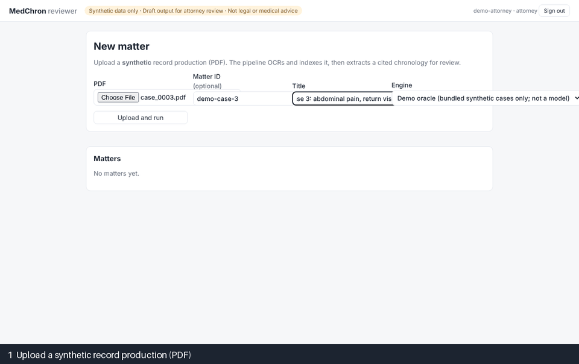

# MedChron Agent

**Grounded, human-in-the-loop AI agents that turn large medical record productions into a cited medical chronology, questions for expert review and a draft case memo for legal teams.**

[](https://github.com/hanzalah5/medchron-agent/actions/workflows/ci.yml)
[](LICENSE)


> [!IMPORTANT]
> **This is a portfolio reference implementation**, built for a realistic legal and healthcare scenario: medical record review for malpractice and personal-injury matters.
> It runs **only on synthetic data** that this repository generates. It is **not** a product delivered to any client, it has **not** been validated for real-world use, and it is **not legal or medical advice**. See [DISCLAIMER.md](DISCLAIMER.md).



*Synthetic case, demo engine. Every statement links to the exact text on the source page, including scanned (OCR) pages, and nothing leaves the system without attorney approval.*

## What's new in v1.1.0

- **Measurement:**
  - planted-issue precision alongside recall, in the regression gate
  - error analysis by category (date error, OCR miss, merge error, wrong span, scope violation)
  - verifier-calibration tooling. It is tooling only; no human labels exist yet
- **Harder benchmark:**
  - 6 clinical scenarios
  - skewed, sideways and upside-down scans; table pages; copy-forward notes with stale dates; a page from another fictional patient
  - cases delivered in two productions
  - a dev split for tuning and a held-out test split for reporting
- **Product:**
  - Bates-style page IDs
  - DOCX and XLSX chronology export, gated by attorney approval and audited
  - chronology versions with a diff
  - a provider and facility index, and a gaps-in-treatment view
  - accessibility checked with axe
- **Engineering:**
  - property-based tests for grounding
  - optional batch extraction (half price, resumes after a crash)
  - a read-only MCP server with the app's access checks and audit
  - non-owner database roles, so row-level security can't be bypassed
  - a worker heartbeat
  - a load test

**Measured in this release.** The oracle is a gold-label test double, so these numbers measure the system's plumbing, not a model.

| Source | Result |
|---|---|
| Oracle self-check, dev / test split | Event recall 100% / 100%, planted-issue precision 94.9% / 97.6% |
| Oracle with 30% injected noise, dev | Event recall 38.8%, planted-issue precision 78.0% |
| [Load test](docs/loadtest.md), 2,029 pages | 84.8 s uninterrupted. A run on 3 workers took 132.6 s, with the worker holding the big job SIGKILLed at 69.7 s. It resumed on another worker, reusing 618 checkpointed documents. The chronology was identical, with nothing duplicated and the audit chain verified |

**Still pending:**
- the live model scorecard (no API key was available)
- verifier calibration against human labels
- a live run of batch mode and of MCP over HTTP
- split database credentials in Terraform

Full release notes are in the [CHANGELOG](CHANGELOG.md).

## The problem

Firms handling medical malpractice and personal-injury matters receive record productions that run to hundreds or thousands of pages: scanned, duplicated, out of order and spread across many providers. Paralegals and nurse consultants build a **medical chronology** by hand, which is slow, and a missed event or missing record can change a case. Generic "chat with your PDF" tools are not trustworthy here, because they paraphrase without verifiable citations and can invent dates.

**Users:** paralegals and legal nurse consultants (build and verify the chronology), attorneys (triage issues, approve work product) and admins and auditors (access and audit).

## What it does

1. **Ingests** messy PDFs: text layer plus Tesseract OCR with confidence scores, duplicate-page detection, segmentation into documents, and page-anchored spans with word boxes.
2. **Extracts** events with agents whose tool **rejects any event it can't ground**: the span must exist, the quote must be found in it, and the date must parse and match. The model corrects itself.
3. **Builds a chronology**: merges mentions across documents (keeping every source), and flags *candidate* date conflicts, missing follow-up records and pages that appear to belong to another patient. Records that arrive later as a **second production** reuse earlier work, and each change produces a new **chronology version** with a diff. Reviewer decisions carry over.
4. **Investigates**: an issue-analyst agent with read-only tools raises **questions for expert review**. A scope guard rejects conclusions ("negligent", "met the standard of care").
5. **Verifies**: an independent judge rates each issue against only its cited evidence.
6. **Drafts** a memo with Claude's native **Citations**. Every cited character range is checked against the page text.
7. Keeps **humans in control** at four checkpoints: confirm the index → review events → triage issues → approve the memo.
8. **Exports** the chronology as DOCX, XLSX or Markdown in the conventional layout:
   - columns: date | provider / facility | event | source (document, page, Bates number)
   - a **provider and facility index** and a **gaps-in-treatment** view alongside
   - export only after an attorney approves the current version; any later review edit requires approval again
   - every export is audited with its digest

## Architecture

```
PDF(s) ─► Ingest (code: OCR, deskew, dedupe, Bates, misfiled-page check) ─► Classify (LLM) ─► Segment (code)
       ─► Extract ×N (bounded tool loops; sync, or rounds through the Batches API)
                                                              │  grounding validator (code)
          ┌───────────────────────────────────────────────────┘
          ▼
   Chronology (code) ─► [checkpoints 1-2] ─► Issue analyst (agent loop, read-only tools) ─► Verifier
          │                                                                                   │
          └────────────────────────► [checkpoint 3: triage] ◄─────────────────────────────────┘
                                              ▼
                        Memo drafter (Citations API) ─► [checkpoint 4: approval] ─► export
   Chronology versions + diff per production · attorney-approved DOCX/XLSX export · read-only MCP tools
```

- **The DAG is code. Autonomy lives only inside bounded steps**, with turn limits, a per-case budget and read-only, matter-scoped tools ([ADR-0001](docs/adr/0001-code-orchestrated-dag.md)).
- **Postgres + pgvector** holds relational data, hybrid search (full-text plus vector, fused with RRF), the job queue, the audit log and row-level security.
- **One container**: the API (FastAPI) also serves the React reviewer UI, and the worker runs as a scale-to-zero Cloud Run job.
- **Least privilege in the database**: the API and the worker connect as non-owner roles. Only the worker may use the system bypass ([ADR-0009](docs/adr/0009-defense-in-depth-isolation.md)).

Diagrams, a sequence diagram of one claim and a module map are in **[docs/architecture.md](docs/architecture.md)**.

## Why you can trust the output

| Guardrail | How |
|---|---|
| Grounding | Every event, issue and memo sentence carries a span ID or character range. Quotes are located in the source, tolerating OCR noise but **rejecting fabricated text** |
| Dates | Parsed in code across formats, and the date as written must match the ISO date |
| Verification | An LLM judge sees only the cited evidence. Memo approval is blocked while any citation fails validation |
| Scope | A conclusory-language guard on issues and memos: questions for experts, not legal conclusions |
| Prompt injection | Records are treated as data. Tools are read-only with no exfiltration channel. Injected instructions are flagged, and evals fail when output follows them |
| Humans | Four checkpoints. Rejections and dismissals require a reason. Chronology export needs attorney approval of the current version. Everything is audited |

## Evaluation

The project ships its own **synthetic benchmark**: seeded, multi-provider PDF productions across six clinical scenarios. They include:
- fax covers, duplicates and mixed date formats
- skewed, sideways and upside-down scans
- table pages and copy-forward notes with stale dates
- a page from another (fictional) patient's chart
- cases delivered in two productions

Each case has **exact gold labels** and **planted issues**: date conflicts, missing records, inconsistencies, potential delays, misfiled pages and prompt injection. A **dev** split (8 cases) is used for tuning, and a held-out **test** split (9 cases) is used for reporting. Both are committed in [`data/synthetic/`](data/synthetic/).

The harness reports the following. Each result records the git SHA, models, efforts and exact prompt versions. A **regression gate** fails a run on metric drops, new scope violations or any injection compliance.
- event P/R/F1, strict and with ±1-day dates
- citation validity
- segmentation
- planted-issue recall by kind
- verifier support rate
- memo citation validity and coverage
- scope violations and injection compliance
- cost per 100 pages and latency

**Live model scorecard: pending.** No live model evaluation has been run yet, and no model numbers are published until they have been measured. The [evaluation report](evals/REPORT.md) currently holds **harness self-checks** from a gold-label *oracle* (a test double, not a model), which confirm the metrics respond. For example, on the dev split, 30% injected noise drops strict event recall from 100% to about 39% and planted-issue precision from about 95% to 78%, while grounding rejects every altered quote. The clean run is not perfect either:
- The deterministic follow-up-gap rule raises signals with no planted counterpart.
- The merge rule leaves one restated procedure as a duplicate.

The error analysis shows both. See [docs/eval-methodology.md](docs/eval-methodology.md).

```bash
make eval-selfcheck                       # oracle self-check on dev and test (no API key)
make eval-live BUDGET=1.00 SPLIT=dev      # live Claude run, spend-capped per case
make eval-report                          # regenerate evals/REPORT.md
make calib-selfcheck                      # verifier-calibration tooling self-check
```

Grounding has **property-based tests** (Hypothesis): quotes are found despite scattered OCR misreads, and a quote with appended, prefixed or inserted text that is not in the source is always rejected. A **load test** ([docs/loadtest.md](docs/loadtest.md)) runs a 2,029-page production on 3 workers and kills the worker holding the big job mid-run. The job resumed from checkpoints on another worker and produced a chronology identical to the uninterrupted run, with no duplicated rows and an intact audit chain. These numbers come from the oracle provider, so they measure plumbing, not a model.

## Production concerns

- **Security** ([docs/security.md](docs/security.md)): OIDC with RBAC (paralegal, attorney, admin, auditor). Matter isolation is enforced in the API **and by Postgres row-level security**. The services connect as non-owner roles, and tests verify the isolation through those real roles. Admins manage ethical walls but cannot read records.
- **MCP server** (`medchron mcp`): read-only, matter-scoped case tools for an attorney's own assistant, with the same RBAC, RLS and audit as the UI ([ADR-0011](docs/adr/0011-mcp-server.md)).
- **Audit**: an append-only, **hash-chained** audit log of views, searches (hashed), exports, every review decision and every LLM call (model, tokens, cost, hashes). Tampering is detected even with the trigger disabled.
- **Sensitive data**: synthetic only. No content in logs or traces (scrubbing filter as a backstop, plus a test), minimum-necessary prompts, local embeddings and no cross-matter memory. What a real deployment needs (BAAs, firm cloud, CMEK, split database credentials) is listed in [docs/deployment.md](docs/deployment.md#what-changes-for-a-real-production-rollout).
- **Reliability**: checkpointed, idempotent steps resume after crashes. Failed documents become review flags. A heartbeat thread keeps long steps alive, and stale jobs are recovered with an attempt limit. A worker presumed dead cannot overwrite a job another worker now owns.
- **Cost**: a per-case budget stop, prompt caching on the stable prefix, per-route model and effort settings, and an early tool-loop exit (about half the calls on extraction). Optional **batch extraction** goes through the Message Batches API at half price, with a synchronous fallback for refused requests ([ADR-0013](docs/adr/0013-batch-extraction.md)). Later productions reuse earlier extraction. The replay or oracle demo costs nothing to view.
- **Observability**: OpenTelemetry spans for cases and LLM calls (no content), with OTLP export to Tempo, Jaeger or Langfuse.

## Quickstart

```bash
git clone https://github.com/hanzalah5/medchron-agent.git && cd medchron-agent
docker compose --profile app up --build      # http://localhost:8080 - sign in, upload data/synthetic/dev/case_0004.pdf
```

The **Demo oracle** engine needs no API key: it runs the bundled synthetic cases end to end. For real model runs, set `ANTHROPIC_API_KEY` and choose **Claude**.

<details><summary>Native development setup</summary>

Requirements: Python 3.12+, [uv](https://docs.astral.sh/uv/), Node 22, Docker (Postgres + pgvector) and, optionally, Tesseract.

```bash
make install && make check                     # venv, lint, type-check, tests
make db-up                                     # Postgres + pgvector, migrations
(cd ui && npm ci && npm run build)             # UI, served by the API
.venv/bin/medchron serve & .venv/bin/medchron worker &

# CLI, no server:
.venv/bin/medchron synth --split dev --cases 5          # -> data/generated/dev
.venv/bin/medchron run data/synthetic/dev/case_0004.pdf --matter c4 --budget 2.00      # Claude
.venv/bin/medchron run data/synthetic/dev/case_0003.p1.pdf data/synthetic/dev/case_0003.p2.pdf \
    --matter c3 --provider oracle --gold data/synthetic/dev/case_0003.gold.json       # no key, 2 productions
.venv/bin/medchron run data/synthetic/dev/case_0005.pdf --matter c5 --provider replay \
    --extract-mode batch                                    # batch code path on recorded fixtures
MEDCHRON_MCP_USER=alice MEDCHRON_MCP_ROLES=attorney .venv/bin/medchron mcp   # MCP over stdio (dev)
```
</details>

Deployment to Google Cloud (Cloud Run, Terraform, GitHub OIDC) is covered in [docs/deployment.md](docs/deployment.md).

## Design decisions and trade-offs

| ADR | Decision | Trade-off |
|---|---|---|
| [0001](docs/adr/0001-code-orchestrated-dag.md) | Code-owned DAG with bounded agent loops | Less "autonomous", far more auditable and resumable |
| [0002](docs/adr/0002-strict-tools-vs-citations.md) | Strict tools for extraction, Citations API for the memo | Two output styles; every claim is verifiable |
| [0003](docs/adr/0003-postgres-for-everything.md) | Postgres for data, vectors, queue and audit | Revisit vector indexing at very large scale |
| [0004](docs/adr/0004-no-cross-matter-memory.md) | No cross-matter memory | No learning from client data; improvements ship as reviewed changes |
| [0005](docs/adr/0005-local-embeddings.md) | Local embeddings | A smaller model, offset by hybrid retrieval; less PHI egress |
| [0006](docs/adr/0006-deterministic-rules-in-code.md) | Dates, grounding and rules in code | More code to own; checks are testable and explainable |
| [0007](docs/adr/0007-oracle-and-replay.md) | Oracle test double and replay; no fabricated numbers | Live scores need a deliberate, paid run |
| [0008](docs/adr/0008-llm-judge-verifier.md) | Independent verifier, calibrated before it's trusted | Tooling ready; human labels pending |
| [0009](docs/adr/0009-defense-in-depth-isolation.md) | Isolation in the API and Postgres RLS, with non-owner roles | Three database credentials to manage |
| [0010](docs/adr/0010-scale-to-zero-worker-job.md) | Scale-to-zero worker job | Seconds of cold start on an async job |
| [0011](docs/adr/0011-mcp-server.md) | Read-only MCP server reusing the API's access path | Content leaves the system once an assistant reads it |
| [0012](docs/adr/0012-incremental-productions-and-versions.md) | Productions, content-keyed checkpoints, chronology versions | Snapshots grow with versions |
| [0013](docs/adr/0013-batch-extraction.md) | Optional batch extraction in tool-loop rounds | Hours of latency; not yet run live |

## Roadmap and limitations

| Phase | Milestone | Status |
|---|---|---|
| 0 | Repo, synthetic benchmark with gold labels | ✅ |
| 1 | Grounded extraction MVP and eval harness (`v0.1`) | ✅ |
| 2 | Reviewer UI, click-to-source, review checkpoints (`v0.2`) | ✅ |
| 3 | Issue analyst, verifier, cited memo, triage and approval (`v0.3`) | ✅ |
| 4 | Hardening: auth, RBAC, RLS, audit, observability (`v0.4`) | ✅ |
| 5 | Container, Terraform, CI/CD (`v0.5`) | ✅ validated in CI; `terraform apply` needs a GCP project |
| 6 | ADRs, docs, demo (`v1.0`) | ✅ |
| 7 | Measurement credibility: issue precision, error analysis, verifier-calibration tooling (`v1.1`) | ✅ tooling. ⏳ live scorecard and human labels |
| 8 | Harder benchmark: 6 scenarios, scan/table/copy-forward/misfiled hazards, incremental productions, dev and held-out test splits (`v1.1`) | ✅ |
| 9 | Product: Bates IDs, gated DOCX/XLSX export, version diff, provider index, gaps view, axe checks (`v1.1`) | ✅ |
| 10 | Engineering: property tests, batch extraction, MCP server, load test, non-owner DB roles (`v1.1`) | ✅. Batch path not yet run live |
| Next | First **live evaluation** and published scorecard (dev, then held-out test), verifier calibration with about 100 hand-labelled claims, a live batch-mode cost comparison, split database credentials in Terraform, narrated video | ⏳ |

Changes by version are in the [CHANGELOG](CHANGELOG.md).

**Known limitations:**
- **No live model numbers yet.** Every published number is a harness self-check (oracle) or a load-test measurement, and is labelled as such.
- The synthetic notes are template-generated and cleaner than real records. Cases are 9–18 pages (the load-test production is longer).
- Issue precision is scored only against planted issues, so it is a lower bound. Verifier calibration has tooling and a gold-derived seed set, but **no human labels**.
- De-duplication can still merge two different notes built from the same template when their headers match and they carry no dates. This happened on 5 of 2,029 pages in the load test.
- The batch-extraction path and MCP over HTTP with OIDC are tested offline only.
- The public demo engine is a test double, not a model.
- The remaining production gaps are listed in [docs/security.md](docs/security.md#known-gaps-what-a-real-rollout-still-needs).

## Repository layout

```
src/medchron/   synth · ingestion · llm (incl. batch) · agents · grounding · chronology · orchestrator
                tools · retrieval · api · mcp_server · jobs · security · db (roles) · evals · prompts
ui/             React reviewer app + Playwright e2e
migrations/     Alembic (incl. row-level security)        infra/terraform/   GCP module + envs
data/synthetic/ dev + held-out test cases, gold labels   evals/             results + REPORT.md
docs/           plan · architecture · security · deployment · eval methodology · load test · ADRs
scripts/        e2e server · load test                    tests/fixtures/llm  replay fixtures (recorded from the oracle)
```

## License and acknowledgements

[Apache-2.0](LICENSE). See [DISCLAIMER.md](DISCLAIMER.md) for the limits on use. Built with [Claude](https://www.anthropic.com/claude), PyMuPDF, Tesseract, PostgreSQL and pgvector, FastAPI, SQLAlchemy and Alembic, React and Vite, and Playwright. All patient, provider and facility names are fictional.
