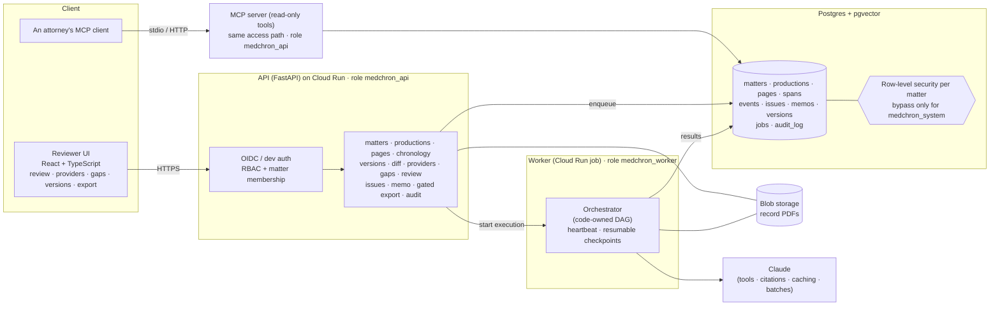
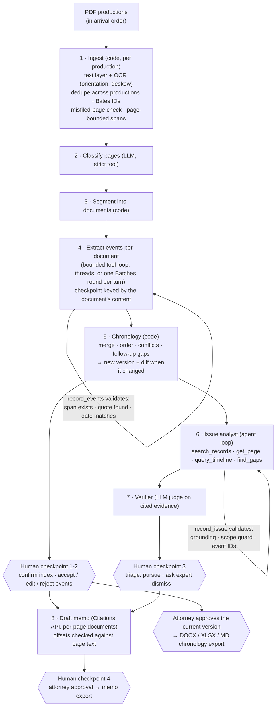
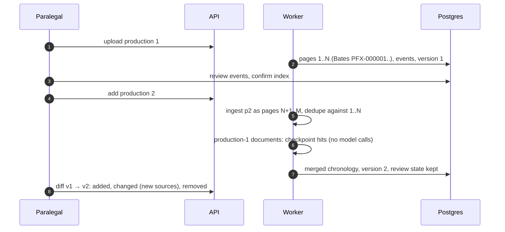
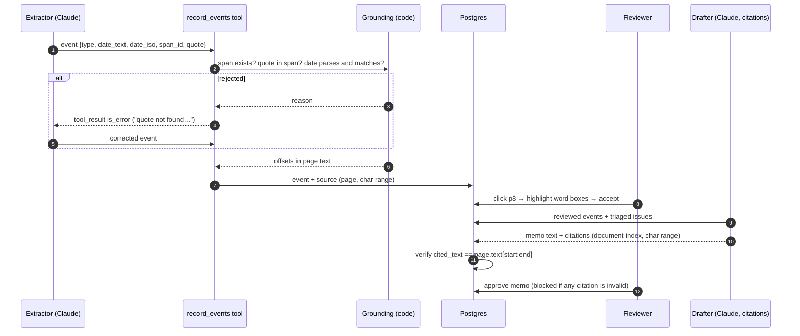

# Architecture

## System overview

## Pipeline (one case)

Every LLM call goes through a metered provider: per-case budget, cost (batch calls at half price), tokens, and audit records holding hashes only. Every step is checkpointed by a key built from its inputs, prompt versions and model settings. Extraction is keyed by each document's own content, so a second production reuses the first's work ([ADR-0012](adr/0012-incremental-productions-and-versions.md)).

## Incremental productions

## Database roles

| Role | Connects | Can |
|---|---|---|
| owner | migrations only | everything |
| `medchron_api` | API, MCP server | rows of matters the caller belongs to (RLS); append to the audit log |
| `medchron_worker` | worker | the same, plus the system bypass for background processing |

The system bypass needs both `medchron.system = on` and membership in `medchron_system` ([ADR-0009](adr/0009-defense-in-depth-isolation.md)).

## The path of one claim

## Where to look in the code

| Concern | Module |
|---|---|
| Ingestion: OCR (orientation, deskew), word boxes, dedupe, Bates, misfiled pages, spans | `src/medchron/ingestion/` |
| Agents | `src/medchron/agents/` (`classifier`, `extractor`, `analyst`, `verifier`, `drafter`) |
| Tool loop (state machine), providers, cost, replay, batches | `src/medchron/llm/` |
| Grounding: quotes, dates | `src/medchron/grounding/` |
| Orchestration and checkpoints | `src/medchron/orchestrator/pipeline.py` |
| Read-only agent tools, hybrid search | `src/medchron/tools/`, `src/medchron/retrieval/` |
| Chronology versions, diff, exports, provider index, gaps | `src/medchron/chronology/` |
| API, jobs, storage | `src/medchron/api/`, `src/medchron/jobs.py`, `src/medchron/storage.py` |
| MCP server | `src/medchron/mcp_server.py`, [ADR-0011](adr/0011-mcp-server.md) |
| Security: auth, access, audit, logs, DB roles | `src/medchron/security/`, `src/medchron/db/roles.py`, `migrations/versions/0005_*`, `0008_*` |
| Load test | `scripts/loadtest.py`, [loadtest.md](loadtest.md) |
| Evaluation | `src/medchron/evals/`, [eval-methodology.md](eval-methodology.md) |
| Infrastructure | `infra/terraform/`, [deployment.md](deployment.md) |

Design decisions are recorded in [`docs/adr/`](adr/).
